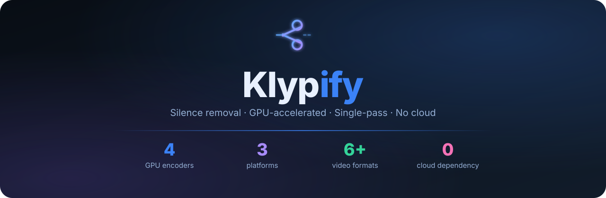

<p align="center"></p>

# Klypify

**Automatically cut silence from videos — one click, GPU-accelerated, no cloud.**

Klypify uses a single-pass FFmpeg pipeline to detect and remove silent sections from any video file. What used to take minutes of sequential re-encodes now runs in one GPU-accelerated pass.

---

## ⬇️ Download

| Platform | File |
|---|---|
| **Windows** | [Klyppr-Portable-x64.exe](https://github.com/parsherr/Klypify/releases/latest) |
| **macOS** | [Klyppr-*.dmg](https://github.com/parsherr/Klypify/releases/latest) |
| **Linux** | [Klyppr-*.AppImage](https://github.com/parsherr/Klypify/releases/latest) |

> Just download, run, and start processing. No installation required on Windows (portable EXE).

---

## ✨ Features

- **Single-pass silence removal** — one FFmpeg encode regardless of how many silent sections exist
- **GPU acceleration** — NVIDIA NVENC (RTX / GTX), Intel Quick Sync, Apple VideoToolbox, AMD VAAPI
- **Audio normalization** — YouTube standard (-16 LUFS, True Peak -1.5 dB)
- **Background music** — loop or sequence tracks, auto-fade, adjustable volume
- **Real-time logs** — see exactly what FFmpeg is doing, with timing for every phase
- Supports MP4, AVI, MOV, MKV and more

---

## 🚀 Usage

1. Click **Browse** and select your video file
2. Choose an output folder
3. Adjust silence settings if needed (defaults work well for most recordings)
4. Click **Start Processing**
5. The output folder opens automatically when done

### Settings explained

| Setting | Default | What it does |
|---|---|---|
| Silence threshold | -28 dB | How quiet counts as silence. Raise for noisier rooms. |
| Min silence duration | 0.2 s | Shorter silences are kept. Lower = more cuts. |
| Padding | 0.05 s | Breathing room kept around each cut. |

---

## ⚡ GPU Acceleration

Klypify auto-detects your GPU at startup and uses hardware encoding when available:

| GPU | Encoder used |
|---|---|
| NVIDIA RTX / GTX | h264_nvenc |
| Intel integrated | h264_qsv |
| AMD / generic Linux | h264_vaapi |
| Apple Silicon / Intel Mac | h264_videotoolbox |
| No GPU / fallback | libx264 (CPU) |

**NVIDIA users:** driver **520 or newer** is required for NVENC. RTX 40-series (Ada Lovelace) requires driver 525+. Check with `nvidia-smi`.

**Linux VAAPI users:** make sure `/dev/dri/renderD128` exists (`ls /dev/dri/`). Install `mesa-va-drivers` if missing.

If you see *"No hardware encoder found — using CPU"*, check your driver version and that FFmpeg was built with hardware encoder support (`ffmpeg -encoders | grep nvenc`).

---

## 🛠️ Build from source

**Prerequisites:** Node.js 18+, FFmpeg binaries in `bin/`

```bash
# Clone
git clone https://github.com/parsherr/Klypify.git
cd Klypify

# Install dependencies
npm install

# Place FFmpeg binaries
# bin/linux/ffmpeg  bin/linux/ffprobe   (Linux)
# bin/win/ffmpeg.exe  bin/win/ffprobe.exe  (Windows)
# bin/mac/ffmpeg  bin/mac/ffprobe   (macOS)
# Download from: https://ffmpeg.org/download.html

# Run in development
npm start

# Build distributable
npm run build:linux    # AppImage
npm run build:win64    # Portable EXE
npm run build:mac      # DMG
```

> On Linux, Klypify prefers the **system FFmpeg** (`/usr/bin/ffmpeg`) over the bundled binary so hardware encoder support (NVENC, VAAPI) is preserved. Install FFmpeg via your package manager for best results:
> ```bash
> sudo apt install ffmpeg          # Ubuntu / Debian
> sudo dnf install ffmpeg          # Fedora
> sudo pacman -S ffmpeg            # Arch
> ```

---

## 📦 Tech stack

- [Electron](https://www.electronjs.org/)
- [fluent-ffmpeg](https://github.com/fluent-ffmpeg/node-fluent-ffmpeg)
- FFmpeg (bundled for Windows/macOS, system-preferred on Linux)

---

## Related

- [Klyppr Web Version](https://github.com/muzafferkadir/klyppr) — browser-based version

## License

MIT
